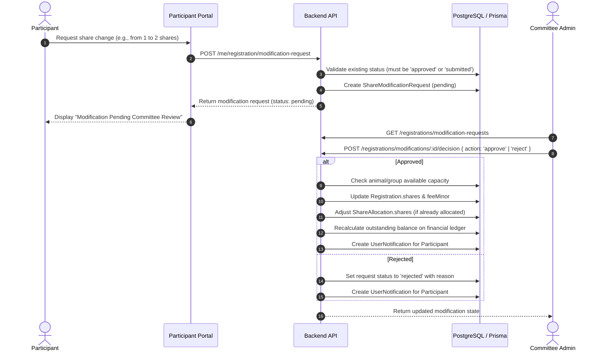

# QurbaniOS — Participant Self-Service Capability Matrix & Workflow Specification

**Document:** `docs/VERIFICATION/PARTICIPANT-CAPABILITY-MATRIX.md`  
**Status:** COMPLETE AUDIT & SPECIFICATION  
**Scope:** Participant Portal (PAR01–PAR08), Razorpay Integration, Share Modifications, Receipts, and Progress Timeline  
**Author:** Subagent C — Participant Workflow Researcher  
**Date:** 2026-11-15  

---

## 1. Executive Summary & Portal Architecture

The Participant Interface in QurbaniOS provides a self-service workspace where participants manage their entire Aḍḥiyah journey—from initial registration and payment tracking to animal allocation, operational tracking, and meat collection.

### 1.1 Structural Foundations
- **Location:** `frontend/src/components/app/ParticipantWorkspace.tsx`
- **Routing:** `/participant/$section` with aliases `/dashboard/$section` (`frontend/src/router.tsx:285-327`).
- **Allowed Roles:** Authenticated users with role `participant` (also accessible by `committee_admin` and `super_admin` for simulation).
- **Security Rule:** Participants are strictly restricted to their own private records (`docs/Features_workflow.md:296-298`). They cannot verify payments, mutate animal allocations, or advance slaughter operations.

---

## 2. Participant Self-Service Capabilities Audit

### 2.1 My Registration (`section: "registration"`)
- **Status in Code:** Partially implemented (displays table dl in `ParticipantWorkspace.tsx:169-194`; backed by `GET /organisations/:orgId/programmes/:programmeId/me/registration`).
- **Capabilities:**
  - Displays Registration Reference ID (e.g., `QOS-2027-001`).
  - Displays status badge (`submitted` [Pending review], `approved` [Approved], `rejected` [Rejected], `cancelled` [Cancelled]).
  - Displays submission timestamp (`submittedAt`) and decision timestamp (`decidedAt`).
  - Displays committee review notes or rejection reason (`decisionReason`).

### 2.2 My Household (`section: "household"`)
- **Status in Code:** Read-only view in `ParticipantWorkspace.tsx:195-210`. Backed by `GET /me/household` and `PUT /me/household`.
- **Capabilities & Rules:**
  - Shows Household Head Name, Full Address, Locality, and Family Members count.
  - Permitted edits: Participant can update name, address, contact phone, and contact email while status is `submitted` or before applying.
  - Once registration is `approved`, household updates must trigger committee review or be locked to prevent delivery confusion.

### 2.3 My Shares (`section: "participation"`)
- **Status in Code:** Read-only metrics display (`ParticipantWorkspace.tsx:211-226`).
- **Capabilities:**
  - Displays Participation Option (e.g., "Cattle share", "Goat").
  - Displays Approved Share Quantity (1 to 7).
  - Displays Unit Price Minor (`unitPriceMinor / 100`) and Total Contribution (`feeMinor / 100`).

### 2.4 Share Modification Request Workflow


### 2.5 My Payments & Transactions (`section: "payments"`)
- **Status in Code:** Semi-functional UI with demo store fallback (`ParticipantWorkspace.tsx:227-281`). Live adapter `financeAdapter.myPayments` called.
- **Capabilities:**
  - **Financial Summary Metrics:** Total Contribution Expected, Total Verified Payments, Outstanding Dues Balance, Pending Submissions count.
  - **Payment Record Submission:** Modal allows submitting payment details (`amount`, `method` [Cash, Bank transfer, UPI], `date`, `reference`, supporting document).
  - **Core Rule:** A submitted payment record is tagged `pending` and does NOT update the official verified balance until audited and approved by the finance committee (`backend/src/finance/finance.service.ts:191-264`).

### 2.6 Razorpay Payment Gateway Integration Specification
To support online debit/credit/UPI contributions, Razorpay integration is architected as follows:
```mermaid
sequenceDiagram
    autonumber
    actor P as Participant
    participant FE as React Frontend (Checkout.js)
    participant BE as NestJS API (/finance/razorpay)
    participant RZ as Razorpay Gateway
    participant DB as Database Ledger

    P->>FE: Click "Pay Online via Razorpay"
    FE->>BE: POST /me/payments/razorpay/order { amountMinor }
    BE->>BE: Validate amount <= outstanding balance
    BE->>RZ: POST /v1/orders { amount, currency: 'INR', receipt: regId }
    RZ-->>BE: Return order { id: 'order_xxx', amount, currency }
    BE-->>FE: Return { orderId, keyId, amount, currency }
    
    FE->>RZ: Open Razorpay Checkout modal
    P->>RZ: Completes UPI / Netbanking / Card payment
    RZ-->>FE: Return { razorpay_payment_id, razorpay_order_id, razorpay_signature }
    
    FE->>BE: POST /me/payments/razorpay/verify
    BE->>BE: Verify HMAC-SHA256(order_id + "|" + payment_id, key_secret)
    BE->>DB: In Serializable Transaction:
    BE->>DB: 1. Create Payment (method: 'upi', status: 'verified', reference: payment_id)
    BE->>DB: 2. Create Receipt (kind: 'payment', amountMinor)
    BE->>DB: 3. Recalculate ledger balance
    BE-->>FE: Return { status: 'verified', receiptId }
    FE-->>P: Show Success Toast & enable View/Print Receipt

    Note over RZ,BE: Asynchronous Webhook Fallback
    RZ->>BE: POST /payments/razorpay/webhook (payment.captured)
    BE->>BE: Verify X-Razorpay-Signature header
    BE->>DB: Idempotent lookup: ensure payment recorded; if not, record & verify
```

### 2.7 My Receipts (`section: "payments"` modal & `section: "receipts"`)
- **Status in Code:** Modal viewer implemented in `ParticipantWorkspace.tsx:410-463`. Backend service implemented in `backend/src/finance/finance.service.ts:290-324`.
- **Capabilities:**
  - Official Verified Receipts issued exclusively upon finance committee verification (`ReceiptKind: 'payment'`) or approval (`ReceiptKind: 'registration'`).
  - Receipt metadata: Unique Receipt Number (`receipt.id.toUpperCase()`), Issue Date (`issuedAt`), Participant Name, Registration Reference, Verified Amount (formatted as ₹ via `money()`), Payment Method.
  - Verification seal / audit badge confirming committee auditing.
  - Actions: On-screen preview, Print layout (`window.print()`), and PDF download URL via `reportsAdapter.getReportExportUrl`.

### 2.8 Qurbani Progress Timeline (`section: "overview"` & `section: "allocation"`)
- **Status in Code:** Visual timeline in `ParticipantWorkspace.tsx:107-127`. Backend live operational data via `GET /me/participation` (`registration.service.ts:278-340`).
- **6-Stage Progress Milestones:**
  1. **Registration Submitted:** Application recorded in database.
  2. **Committee Approval:** Committee reviews household and share request; status becomes `approved`.
  3. **Payment Verified:** Verified payments equal or cover required deposit/total contribution.
  4. **Group Assignment:** Animal Group (`AnimalGroup.name`) and Procured Animal (`Animal.reference`) published by committee.
  5. **Operational Preparation:** Slaughter completed, Cutting, Weighing (actual grams), Packaging completed by ground volunteers.
  6. **Collection Confirmed:** Assigned collection window (`CollectionWindow`), pickup location, package quantity (kg), and verified collection reference UUID (`collectionReference`).

### 2.9 Notifications & Announcements (`section: "updates"` & overview)
- **Status in Code:** Announcements feed working via `communicationsAdapter.publicAnnouncements` and `records.announcements`. In-app notifications supported in backend `backend/src/communications/communications.controller.ts:100-123`.
- **Capabilities:**
  - Direct in-app notices for status updates (e.g. "Registration approved", "Payment verified", "Package ready").
  - Committee broadcast announcements filtered by audience (`Participants` or `All users`).
  - Read/unread acknowledgment (`PATCH /me/notifications/:id`).

---

## 3. Participant Capability Matrix Table

| Feature / Screen | Capability Description | Backend API Route | Frontend Component | Implementation Status | Enhancements Needed |
|---|---|---|---|---|---|
| **PAR01 Dashboard** | Overview of participation, shares, outstanding balance, active timeline stage, latest notices | `GET /me/participation`, `GET /me/payments` | `ParticipantWorkspace.tsx` (`overview`) | Semi-functional (demo store + partial live) | Bind all metric cards to live TanStack queries |
| **PAR02 Household** | View verified household, address, contact details, dependents | `GET /me/household`, `PUT /me/household` | `ParticipantWorkspace.tsx` (`household`) | Read-only in UI | Add inline edit form for address/phone pre-approval |
| **PAR03 Registration** | View submitted application details, status badge, committee review decision | `GET /me/registration` | `ParticipantWorkspace.tsx` (`registration`) | Read-only | Build interactive multi-step registration wizard |
| **PAR04 Participation** | Selected option details, share count, share pricing | `GET /me/participation` | `ParticipantWorkspace.tsx` (`participation`) | Read-only | Add "Request Share Modification" button and modal |
| **PAR05 Payments** | Ledger dues, submit payment record, transaction history | `GET /me/payments`, `POST /payments` | `ParticipantWorkspace.tsx` (`payments`) | Functional modal with mock/live fallback | Add Razorpay Online Checkout button |
| **PAR06 Receipts** | View official verified receipt, print, PDF export | `GET /me/receipts`, `GET /receipts/:id` | `ParticipantWorkspace.tsx` (`Modal viewReceipt`) | Implemented (print ready) | Add direct PDF download link |
| **PAR07 Tracking** | Ground operational progress tracking (slaughter, cutting, weighing, packaging) | `GET /me/participation` (`operations`) | `ParticipantWorkspace.tsx` (`allocation`, `overview`) | Read-only demo | Map live `Schedule` status changes to progress icons |
| **PAR08 Collection** | Handover location, pickup window, personal package quantity, collection UUID | `GET /me/participation` (`distribution`) | `ParticipantWorkspace.tsx` (`collection`) | Implemented | Render QR Code / barcode of `collectionReference` |
| **PAR09 Updates** | In-app notification inbox, committee announcements | `GET /me/notifications`, `GET /announcements` | `ParticipantWorkspace.tsx` (`updates`) | Partial (announcements only) | Wire `InboxController` for user notification badges |
